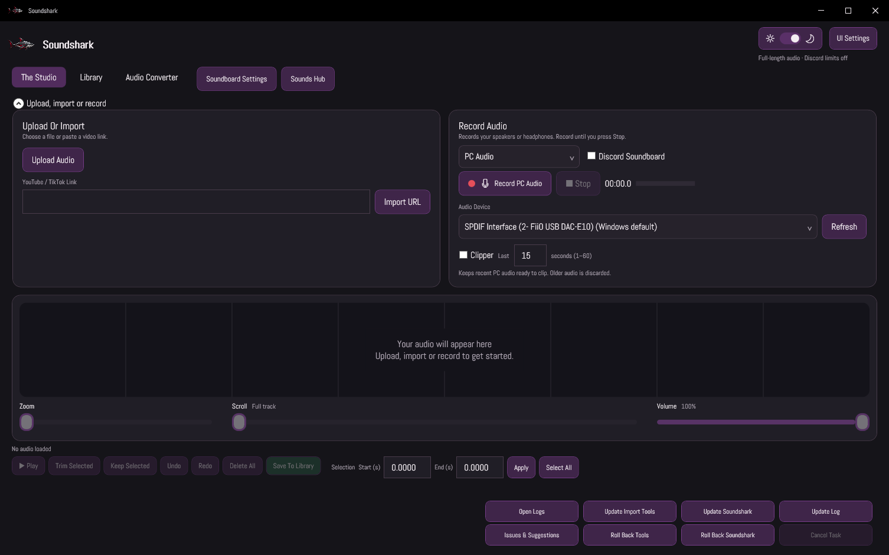
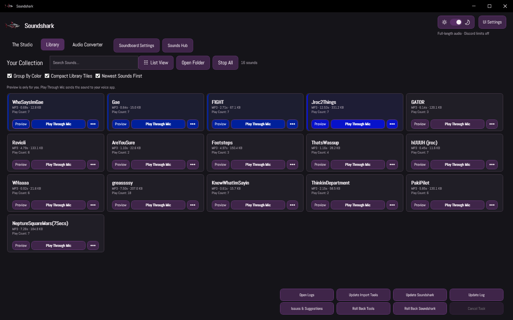

<div align="center">


A native Windows audio studio for recording, editing, converting, and playing your favorite sounds.

[](https://github.com/afkcodinglol/Soundshark/releases/latest)
[](LICENSE)


[**Download**](https://github.com/afkcodinglol/Soundshark/releases/latest) · [**Explore the features**](#made-for-your-everyday-audio) · [**Get the source**](#source--development) · [**Get involved**](CONTRIBUTING.md)

</div>

---

## One place for your sounds

Capture a moment from your PC, trim a recording, build a soundboard, or convert a folder of audio. Soundshark brings it together in a customizable desktop app, with local audio processing and originals that stay untouched.

Local recording, editing, conversion, and previews work without an account. Sign in to **Sounds Hub** to browse and share community clips.

**The Studio** — record or import, trim your track, and set its preview and saved volume.



**Your Library** — switch between Grid and List views, arrange sounds, and keep playback controls close by.



## Made for your everyday audio

| | What you can do |
| :--- | :--- |
| **🎙️ Record & capture** | Record PC audio or a microphone. Keep the last **1–60 seconds** of PC audio ready to grab with Clipper. |
| **✂️ Edit with confidence** | Start with the full track in view, zoom and scroll where needed, trim or keep a selection, and undo or redo edits. Set precise start and end times without changing the original import. |
| **🔉 Control clip volume** | Loud imports are brought down before preview. Set track **Volume** for both preview and saved output, with a final loudness and peak check on export. |
| **🎛️ Organize your Library** | Choose **Grid or List**, search sounds, color buttons, group by color, and see each sound's **Play Count**. Drag List rows into a saved custom order, with animated movement and edge scrolling. |
| **🦈 Discover Sounds Hub** | Sign in with a username or email, optionally remember your login for **30 days**, preview community sounds, and share clips up to **60 seconds / 10 MB**. [Account and sharing guide](docs/SOUNDS-HUB.md). |
| **⌨️ Play it your way** | Assign keyboard and mouse shortcuts with **Mic / Preview / Both** routes, plus per-sound **push-to-talk keys held during playback**. Global shortcuts, pass-through, and left/right modifier detection are automatic. Microphone playback needs optional setup below. |
| **🔄 Convert your collection** | Batch convert **MP3, WAV, FLAC, M4A, OGG, Opus, and AIFF** with automatic settings. Compatible streams are preserved without re-encoding. |
| **🔗 Bring in a clip** | Import individual public **YouTube, Shorts, and TikTok** links with progress and cancellation. Import tools can be updated separately. |
| **💬 Prepare Discord sounds** | Enable Discord Soundboard mode for **MP3, five encoded seconds, and 512,000 bytes** limits. Output is checked before saving. |
| **🎨 Make it yours** | Use the main-window light/dark switch, choose an accent and text size, or load **TTF, OTF, TTC, or OTC** fonts. **Performance Mode** reduces animation and disables drag arranging. |
| **⬆️ Keep moving** | Check for app updates, update import tools, and roll back to a verified local app backup while retaining sounds and settings. |
| **💡 Send feedback** | Use **Issues & Suggestions** to send a problem or idea with up to **five selected log files**, or open a public GitHub issue. |

### List ordering that stays yours

Choose **List View**, then drag a sound by its left grip. Other rows slide aside as you move it; hold near an edge to scroll. Drop to save, or press **Escape** to cancel. Arranging filtered results keeps hidden sounds in their slots, and new sounds append to your custom order. Choose **Group By Color** or **Newest Sounds First** to return to automatic sorting.

Performance Mode keeps both views available while disabling drag ordering and its animations.

## Get Soundshark

**Windows 10/11 · x64 · self-contained downloads** — no separate .NET runtime installation needed.

| Choose your setup | Download |
| :--- | :--- |
| **Installer** — the regular Windows setup experience | [Download installer](https://github.com/afkcodinglol/Soundshark/releases/latest/download/Soundshark-Setup-x64.exe) |
| **Portable** — extract the ZIP and run `Soundshark.exe` | [Download portable ZIP](https://github.com/afkcodinglol/Soundshark/releases/latest/download/Soundshark-portable-x64.zip) |
| **Source** — inspect, modify, and build it yourself | [Download source ZIP](https://github.com/afkcodinglol/Soundshark/releases/latest/download/Soundshark-source.zip) |

[Release notes & all downloads](https://github.com/afkcodinglol/Soundshark/releases) · [SHA-256 checksums](https://github.com/afkcodinglol/Soundshark/releases/latest/download/SHA256SUMS.txt)

1. Install Soundshark, or extract the portable download.
2. Open **The Studio** to record or import audio, then save a clip to **Library**.
3. Preview your sounds, assign shortcuts, or open **Audio Converter** for batch conversions.

### Optional microphone playback

**Preview** plays locally. The local microphone preview build offers **Soundshark Virtual Mic — VB-CABLE**, which mixes continuous voice and clips into separately installed VB-CABLE, and **Physical Mic — Experimental**, which retains the native setup. In virtual mode select **CABLE Output** in Discord/games and keep Soundshark running; closing the main window keeps enabled routing in the tray. Virtual routing stays opt-in and does not change AudioDG protection.

Physical setup requires administrator access and a Windows restart. Its current unsigned component disables protected AudioDG system-wide, reducing Windows audio protection and potentially affecting protected media. Selecting virtual mode alone does not restore a legacy policy change; an explicit cleanup action restores verified backups. Existing users keep their selected route. The new virtual build is local-only pending hardware/platform testing and a separate publication request.

Read the [microphone setup and removal guide](docs/MICROPHONE.md) before enabling it. Compatibility varies by device and voice app; universal Discord/game compatibility is not claimed. Recording, editing, conversion, and local previews are available without this optional component.

## Source & development

**Soundshark's own code is MIT licensed.** Read it, change it, learn from it, and build your own version under the [MIT license](LICENSE).

The application source is available **right here in the repository**. Browse [the desktop app](src/Soundshark), [audio core](src/Soundshark.Core), or [Sounds Hub backend](src/Soundshark.Hub). Each release also includes a [source ZIP](https://github.com/afkcodinglol/Soundshark/releases/latest/download/Soundshark-source.zip) matching that version.

| Source folder | Purpose |
| :--- | :--- |
| `src/Soundshark` | Native Windows interface, recording, Library, and playback workflows |
| `src/Soundshark.Core` | Shared audio and application logic |
| `src/Soundshark.Hub` | Supabase database setup, Edge Function, and backend checks |
| `tests` | Standalone regression checks and native component checks |
| `scripts` & `packaging` | Tool setup, native builds, packaging, and release scripts |

### Build it yourself

Clone the repository or extract a release source archive, then open PowerShell in its root on Windows. The desktop app uses **C#, WPF, and .NET 10**; the SDK is pinned in [`global.json`](global.json).

```powershell
# Build the desktop application
dotnet build src/Soundshark -c Release

# Run the standalone checks after setting up the media tools below
dotnet run --project tests/Soundshark.Checks -c Release -- outputs/qa
```

Audio operations and the full regression suite need the pinned FFmpeg/ffprobe and import tools. Follow the [dependency notes](docs/DEPENDENCIES.md) and [`scripts/Fetch-Tools.ps1`](scripts/Fetch-Tools.ps1); binaries are excluded from Git. Full packaging also needs the native build dependencies and Inno Setup 6. See the [validation notes](docs/ACCEPTANCE.md). The [Hub backend guide](src/Soundshark.Hub/README.md) covers database and Edge Function setup for your own deployment.

Third-party components retain their own licenses. The MIT license does not replace those obligations; see [dependencies](docs/DEPENDENCIES.md) and [third-party notices](docs/NOTICES.txt), including the documented FFmpeg redistribution audit limitation.

## Help shape Soundshark

Found a bug or have an idea? Use **Issues & Suggestions** in the app for private feedback, or [open a GitHub issue](https://github.com/afkcodinglol/Soundshark/issues) for public discussion. Review selected logs before sharing them. Code and documentation contributions are welcome through pull requests; include a focused change and explain what you tested.

[**Contribution guide**](CONTRIBUTING.md) · [User guide](docs/USER-GUIDE.md) · [Updates & rollback](docs/UPDATES.md) · [Microphone guide](docs/MICROPHONE.md)

---

<div align="center">

[Download Soundshark](https://github.com/afkcodinglol/Soundshark/releases/latest) · [Read the license](LICENSE) · [Report an issue](https://github.com/afkcodinglol/Soundshark/issues)

</div>
