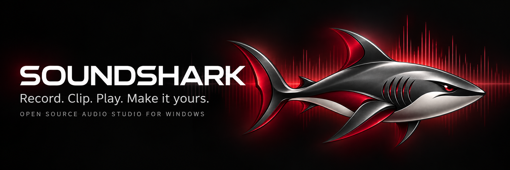
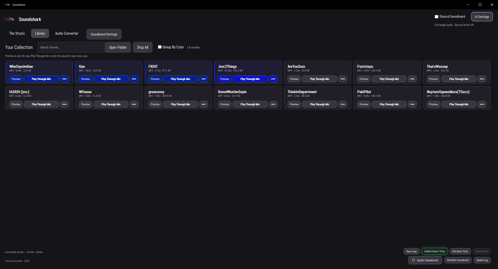
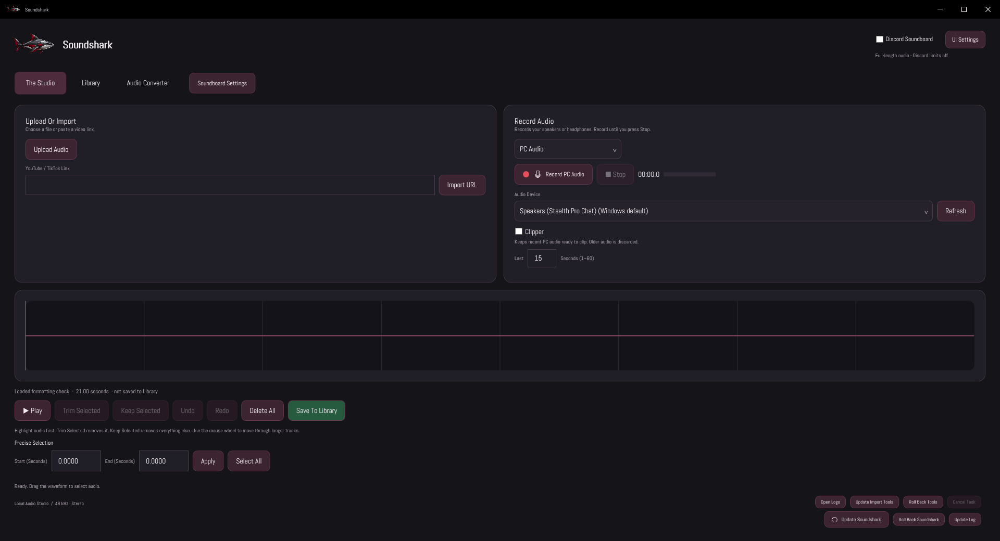
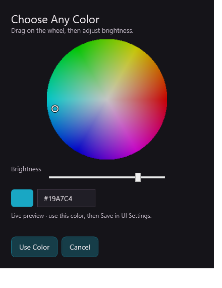

<div align="center">



A native Windows audio studio for recording, editing, converting, and playing your favorite sounds.

[](https://github.com/afkcodinglol/Soundshark/releases/latest)
[](LICENSE)


[**Download**](https://github.com/afkcodinglol/Soundshark/releases/latest) · [**Explore the features**](#made-for-your-everyday-audio) · [**Get the source**](#open-source-and-yours-to-build) · [**Get involved**](CONTRIBUTING.md)

</div>

---

## One place for your sounds

Capture a moment from your PC, trim a recording, build a soundboard, or convert a folder of audio. Soundshark brings it together in a customizable desktop app, with local audio processing and originals that stay untouched.



## Made for your everyday audio

| | What you can do |
| :--- | :--- |
| **🎙️ Record & capture** | Record PC audio or a microphone. Keep the last **1–60 seconds** of PC audio ready to grab with Clipper. |
| **✂️ Edit with confidence** | Trim a selection, keep only the part you want, and undo or redo edits. Set precise start and end times without changing the original import. |
| **🎛️ Build your soundboard** | Search your Library, preview locally, color your sound buttons, group by color, and stop individual sounds or everything at once. |
| **⌨️ Play it your way** | Assign keyboard and mouse shortcuts with **Mic / Preview / Both** routes, modifier controls, and shortcut conflict checks. Microphone playback needs optional setup below. |
| **🔄 Convert your collection** | Batch convert **MP3, WAV, FLAC, M4A, OGG, Opus, and AIFF** with automatic settings. Compatible streams are preserved without re-encoding. |
| **🔗 Bring in a clip** | Import individual public **YouTube, Shorts, and TikTok** links with progress and cancellation. Import tools can be updated separately. |
| **💬 Prepare Discord sounds** | Enable Discord Soundboard mode for **MP3, five encoded seconds, and 512,000 bytes** limits. Output is checked before saving. |
| **🎨 Make it yours** | Choose dark or light mode, accent colors, fonts, text size, Library spacing, and reduced motion. Preview changes before saving. |
| **⬆️ Keep moving** | Check for app updates, update import tools, and roll back to a verified local app backup while retaining sounds and settings. |

<details>
<summary><strong>See The Studio and appearance controls</strong></summary>

### The Studio

Import, record, select, and edit in one shared track.



### Your setup, your style

Adjust the accent with a live color wheel and preview your changes.



Screenshots show the app with demonstration audio and test collections.

</details>

## Get Soundshark

**Windows 10/11 · x64 · self-contained downloads** — no separate .NET runtime installation needed.

| Choose your setup | Download |
| :--- | :--- |
| **Installer** — the regular Windows setup experience | [Download installer](https://github.com/afkcodinglol/Soundshark/releases/latest/download/Soundshark-Setup-x64.exe) |
| **Portable** — extract the ZIP and run `Soundshark.exe` | [Download portable ZIP](https://github.com/afkcodinglol/Soundshark/releases/latest/download/Soundshark-portable-x64.zip) |
| **Source** — inspect, modify, and build it yourself | [Download source ZIP](https://github.com/afkcodinglol/Soundshark/releases/latest/download/Soundshark-source.zip) |

[Release notes & all downloads](https://github.com/afkcodinglol/Soundshark/releases) · [SHA-256 checksums](https://github.com/afkcodinglol/Soundshark/releases/latest/download/SHA256SUMS.txt)

1. Install Soundshark, or extract the portable download.
2. Open **The Studio** to record or import audio, then save a clip to **Library**.
3. Preview your sounds, assign shortcuts, or open **Audio Converter** for batch conversions.

### Optional microphone playback

**Preview** plays locally. **Play Through Mic** uses an experimental native microphone component to add clips to a selected physical microphone.

Enabling it requires administrator access and a Windows restart. Setup disables protected AudioDG system-wide, reducing Windows audio protection and potentially affecting protected media. Removing the last supported microphone restores the saved policy. Portable copies require the same machine-wide setup.

Read the [microphone setup and removal guide](docs/MICROPHONE.md) before enabling it. Compatibility varies by device and voice app; universal Discord/game compatibility is not claimed. Recording, editing, conversion, and local previews are available without this optional component.

## Open source and yours to build

**Soundshark's own code is MIT licensed.** Read it, change it, learn from it, and build your own version under the [MIT license](LICENSE).

The application source is currently distributed as **`Soundshark-source.zip` in GitHub Releases**. This repository is the home for downloads, documentation, and issue reports. Download the [latest source archive](https://github.com/afkcodinglol/Soundshark/releases/latest/download/Soundshark-source.zip) to explore the implementation.

| Inside the source archive | Purpose |
| :--- | :--- |
| `src/Soundshark` | Native Windows interface, recording, Library, and playback workflows |
| `src/Soundshark.Core` | Shared audio and application logic |
| `tests` | Standalone regression checks and native component checks |
| `scripts` & `packaging` | Tool setup, native builds, packaging, and release scripts |

### Build it yourself

Extract the source archive and open PowerShell in its root. The desktop app uses **C#, WPF, and .NET 10**; the SDK is pinned in `global.json`.

```powershell
# Build the desktop application
dotnet build src/Soundshark -c Release

# Run the standalone checks on Windows
dotnet run --project tests/Soundshark.Checks -c Release -- outputs/qa
```

Full packaging also needs the pinned audio/import tools, native build dependencies, and Inno Setup 6. Use the scripts included in the source archive and review the [dependency notes](docs/DEPENDENCIES.md) and [validation notes](docs/ACCEPTANCE.md).

Third-party components retain their own licenses. The MIT license does not replace those obligations; see [dependencies](docs/DEPENDENCIES.md) and [third-party notices](docs/NOTICES.txt), including the documented FFmpeg redistribution audit limitation.

## Help shape Soundshark

Found a bug, have an idea, or want to improve the docs? [Open an issue](https://github.com/afkcodinglol/Soundshark/issues) and help make Soundshark better. Code contributions can start with the release source archive; include a focused patch and validation details in your issue.

[**Contribution guide**](CONTRIBUTING.md) · [User guide](docs/USER-GUIDE.md) · [Updates & rollback](docs/UPDATES.md) · [Microphone guide](docs/MICROPHONE.md)

---

<div align="center">

**Made for people who like their audio tools open and their sounds their own.**

[Download Soundshark](https://github.com/afkcodinglol/Soundshark/releases/latest) · [Read the license](LICENSE) · [Report an issue](https://github.com/afkcodinglol/Soundshark/issues)

</div>
